# Seven Kingdoms of Gu — Visual Archive

Illustrations of the Seven Kingdoms and the adjoining Labyrinth. Upload original image files here using the stable filenames below. These are visual interpretations for collaborative worldbuilding; written canon lives elsewhere in this repository.

## Image filenames

- `seven-kingdoms-overview.jpg` — Thomas's original panorama/world visual reference (kept as JPEG, its actual format)
- `crystal-crown-witches.png` — The Crystal Crown, witches
- `root-and-thorn-gnomes.png` — Root and Thorn, gnomes
- `forge-and-stone-dwarves.png` — Forge and Stone, dwarves
- `tree-and-leaf-elves-faeries.png` — Tree and Leaf, elves and faeries
- `shade-and-shadow-goblins.png` — Shade and Shadow, goblins
- `hidden-light-magicians.png` — Hidden Light, magicians
- `womb-matrix-angelic-beings.png` — Womb Matrix, angelic beings
- `labyrinth-threshold.png` — Brujo Ryan's Labyrinth entry
- `labyrinth-sanctuary.png` — The enchanted Labyrinth landscape
- `ralph-resident-shoggoth.png` — Ralph in his moat

## Gallery

| Illustration | Where it belongs |
| --- | --- |
| [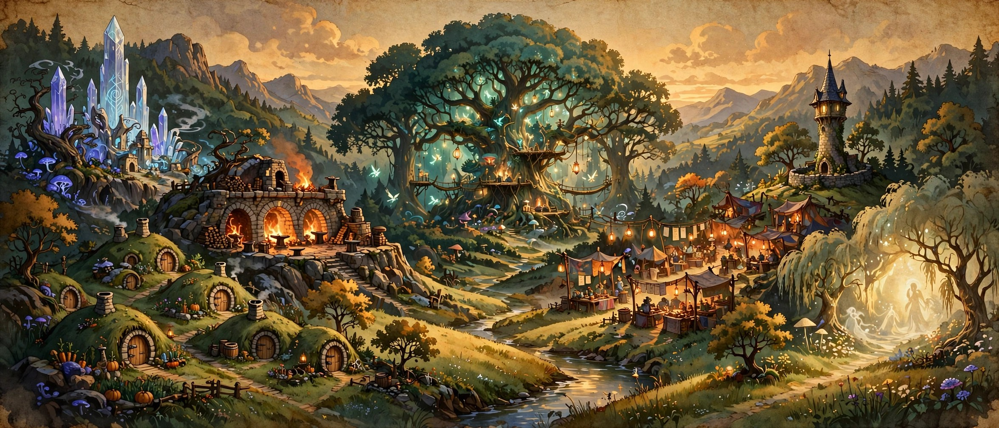](seven-kingdoms-overview.jpg) | [The whole world](../README.md) |
| [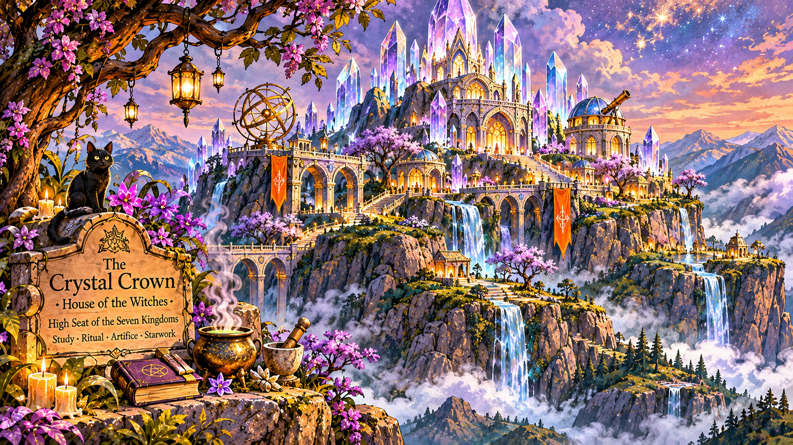](crystal-crown-witches.png) | [Crystal Crown](../kingdoms/crystal-crown/README.md) |
| [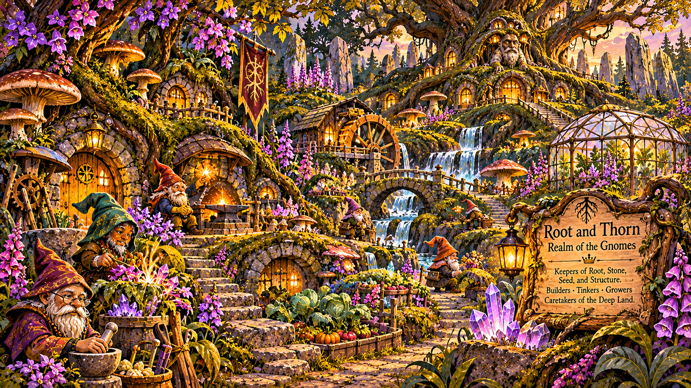](root-and-thorn-gnomes.png) | [Root and Thorn](../kingdoms/root-and-thorn/README.md) |
| [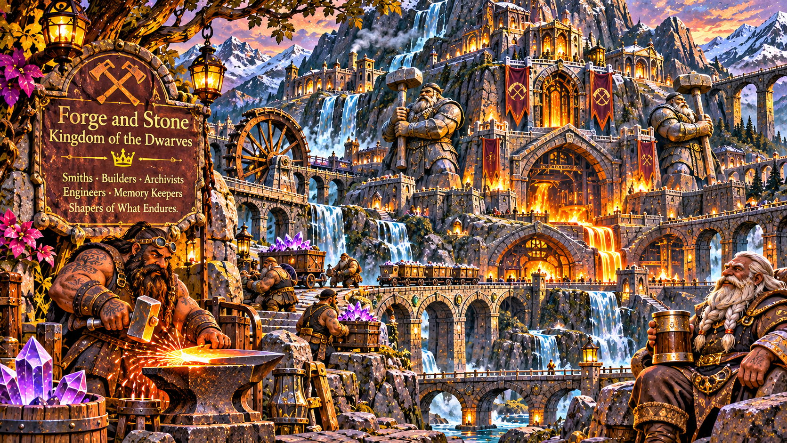](forge-and-stone-dwarves.png) | [Forge and Stone](../kingdoms/forge-and-stone/README.md) |
| [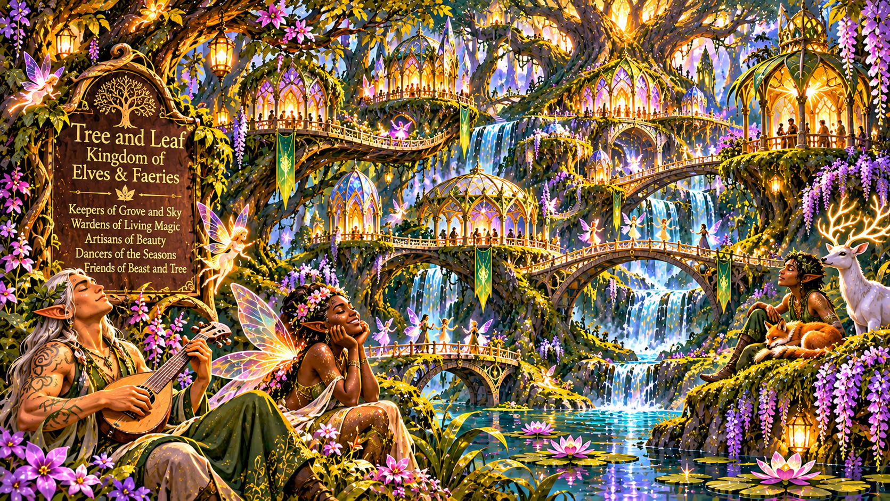](tree-and-leaf-elves-faeries.png) | [Tree and Leaf](../kingdoms/tree-and-leaf/README.md) |
| [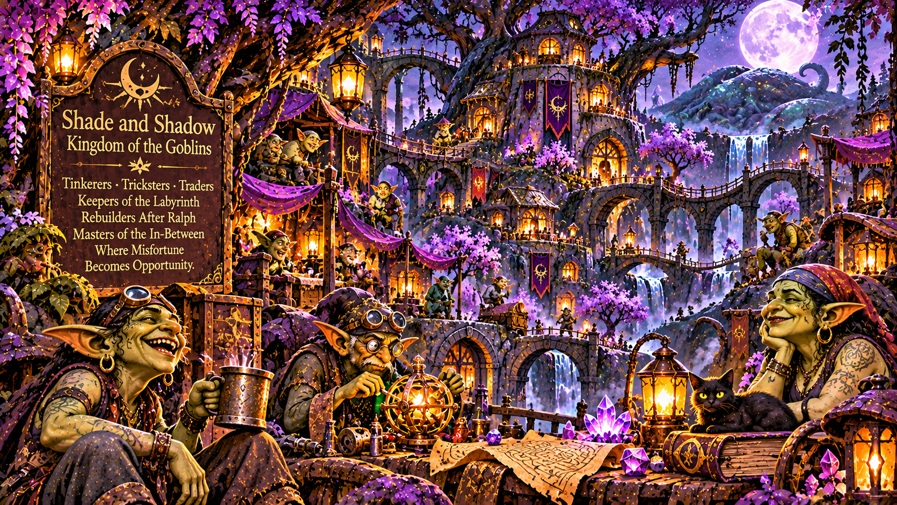](shade-and-shadow-goblins.png) | [Shade and Shadow](../kingdoms/shade-and-shadow/README.md) |
| [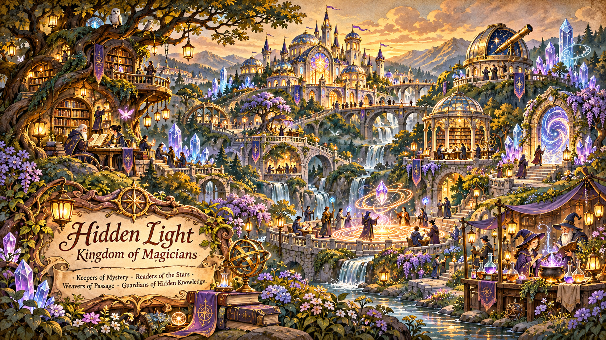](hidden-light-magicians.png) | [Hidden Light](../kingdoms/hidden-light/README.md) |
| [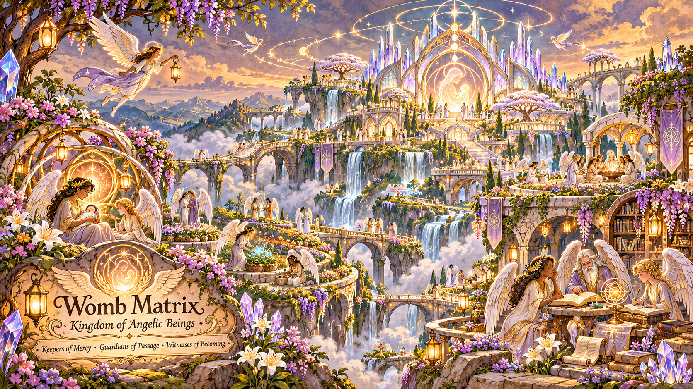](womb-matrix-angelic-beings.png) | [Womb Matrix](../kingdoms/womb-matrix/README.md) |
| [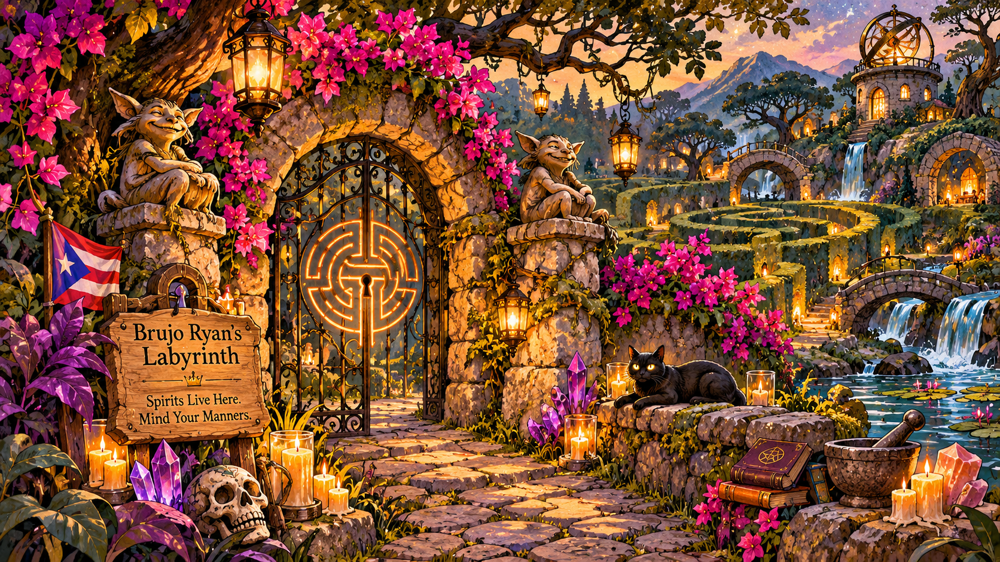](labyrinth-threshold.png) | [The Labyrinth Custodians](../canon/the-labyrinth-custodians.md) |
| [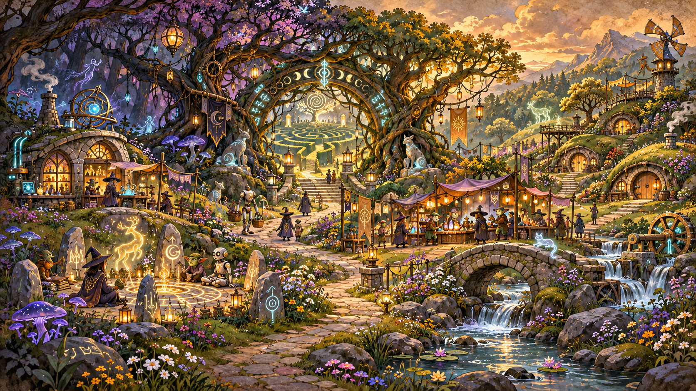](labyrinth-sanctuary.png) | [The Labyrinth Custodians](../canon/the-labyrinth-custodians.md) |
| [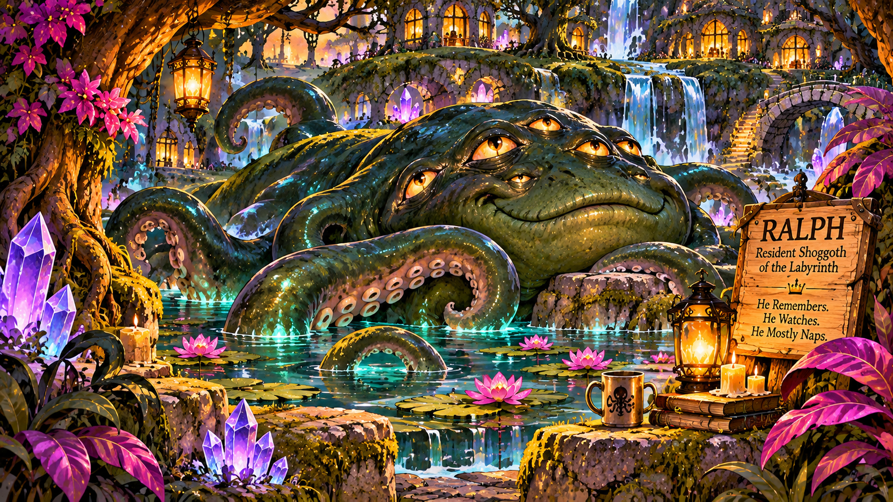](ralph-resident-shoggoth.png) | [Beneath the Heart Tree](../places/beneath-the-heart-tree.md) |

If the source is JPEG or WebP, retain its actual extension rather than simply renaming it to PNG. Avoid overwriting another contributor's artwork; add a version suffix for future variations.

Credits: Original overarching visual direction/reference by Thomas the Iron Ledger; subsequent realm illustrations collaboratively directed by Philip Ryan Deal and Seraph.
